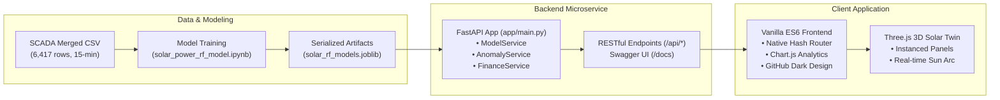

# SolarIQ: Solar Power Generation Prediction & Performance Deviation Analysis

[](https://github.com/pandu/SolarIQ/actions)
[](https://www.python.org/)
[](https://fastapi.tiangolo.com/)
[](https://scikit-learn.org/)
[](LICENSE)

SolarIQ is an industrial-grade intelligence platform that pairs physics-informed machine learning with an interactive 3D digital twin dashboard to forecast solar plant AC output, detect operational performance deviations, and quantify financial impact.

---

## Architecture Overview



---

## Key Features

1. **Overview & 3D Digital Twin (`#/`):**
   - Full-screen procedural WebGL solar array with dynamic sunlight tracking and panel tilt orientation.
   - Real-time facility telemetry statistics and direct navigation tiles.
2. **Solar Power Prediction (`#/prediction`):**
   - Forecast AC output from instantaneous irradiation and temperature parameters.
   - Interactive 96-point diurnal typical day curve comparison.
   - SVG circular gauge displaying output percentage relative to daily peak capacity.
3. **Performance Deviation Analysis (`#/anomaly`):**
   - Physics-grounded anomaly detection evaluating deviations beyond dynamic spread bounds ($K = 3.5$ default).
   - Instant presets: Normal Midday, Underperforming Output, and Zero Reading (data gap).
   - Strict investigation guidelines (candidate identification without diagnosing equipment faults).
4. **Weather Driver Analysis (`#/weather`):**
   - Pairwise Pearson cross-correlation matrix heatmap.
   - Gini impurity feature importance showing solar irradiation accounts for $>96\%$ of predictive power.
   - Scatter plots for irradiation, ambient air temperature, and module surface temperature.
5. **Historical Time-Series Batch Ingestion (`#/historical`):**
   - Drag-and-drop CSV upload supporting up to 5 MB files with 15-minute readings.
   - One-click demo analysis processing 1,150 operational test records.
   - Daily anomaly heat-strip and interactive time-series zoom controls (`All`, `Last 24h`, `Last 7d`).
   - Paginated, searchable flagged rows table with one-click CSV results export.
6. **Model Architecture Benchmarks (`#/performance`):**
   - Chronological split timeline preventing future look-ahead data leakage.
   - 6-experiment validation comparison across Linear Regression, SVR, and Tuned Random Forest.
   - Normalized Root Mean Squared Error (NRMSE %) for cross-plant capacity parity.
   - Residual error distribution histograms and actual vs. predicted parity scatter plots.
7. **Financial Impact & Monetization (`#/financial`):**
   - Quantifies energy shortfall, surplus generation, and net financial balance based on custom PPA tariffs (₹/kWh).
   - Daily stacked shortfall charts and shortfall composition donut diagrams.
   - *"What-If"* single-interval point valuation mini-calculator.

---

## Machine Learning & Performance Summary

SolarIQ implements dedicated Random Forest regressors tuned independently for each solar generation facility:
- **Facility 1 (ID: `4135001`):** Large-scale utility facility (~$25\text{ MW}$ peak capacity).
- **Facility 2 (ID: `4136001`):** Distributed solar installation (~$3.5\text{ MW}$ peak capacity).

### Inputs & Targets
- **Inputs:** `IRRADIATION` ($\text{kW/m}^2$), `AMBIENT_TEMPERATURE` (°C), `MODULE_TEMPERATURE` (°C).
- **Target:** `AC_POWER` ($\text{kW}$), clipped at $\ge 0.0\text{ kW}$.

### Split & Benchmark Scores
Chronological time-ordered split: **Train** (15 May – 06 Jun 2020), **Validation** (07 Jun – 11 Jun 2020), **Test** (12 Jun – 17 Jun 2020).

| Facility | Test $R^2$ | Test MAE (kW) | Test RMSE (kW) | NRMSE (% of Mean) | Best Estimator Parameters |
| :--- | :---: | :---: | :---: | :---: | :--- |
| **Plant 1** | **0.995** | 270.9 | 539.2 | **8.8%** | `n_estimators=100`, `min_samples_leaf=3` |
| **Plant 2** | **0.882** | 885.9 | 1,918.2 | **42.7%** | `n_estimators=100`, `min_samples_leaf=5` |

---

## Quick Start Guide

### Prerequisites
- Python 3.13+ installed
- Modern WebGL-capable browser (Chrome, Edge, Firefox, Safari)

### Installation & Launch

1. **Clone the repository:**
   ```bash
   git clone https://github.com/<your-username>/SolarIQ.git
   cd SolarIQ
   ```

2. **Create and activate a virtual environment:**
   ```bash
   python -m venv .venv
   # Windows:
   .venv\Scripts\activate
   # Linux/macOS:
   source .venv/bin/activate
   ```

3. **Install dependencies:**
   ```bash
   pip install -r backend/requirements.txt
   pip install -r backend/requirements-dev.txt
   ```

4. **Start the FastAPI application:**
   ```bash
   cd backend
   python -m uvicorn app.main:app --reload --port 8000
   ```

5. **Access the application:**
   - **Interactive Web Dashboard:** [http://localhost:8000](http://localhost:8000)
   - **Interactive OpenAPI Swagger Docs:** [http://localhost:8000/docs](http://localhost:8000/docs)
   - **Alternative ReDoc:** [http://localhost:8000/redoc](http://localhost:8000/redoc)

---

## REST API Contract

All responses are serialized JSON. Input validations return HTTP 400/422 with descriptive error messages.

| Method | Endpoint | Description |
| :--- | :--- | :--- |
| `GET` | `/api/health` | Service health status check |
| `GET` | `/api/meta` | Active plant IDs, features, thresholds, and operational defaults |
| `POST`| `/api/predict` | Predict AC power (kW) for single weather and time input |
| `GET` | `/api/typical-day?plant_id=` | 96-slot diurnal curve of average conditions and expected generation |
| `POST`| `/api/anomaly` | Evaluate single telemetry reading against model bounds |
| `POST`| `/api/upload` | Upload SCADA CSV file for batch evaluation (returns `analysis_id`) |
| `GET` | `/api/demo-analysis` | One-click analysis of bundled demo dataset |
| `GET` | `/api/analysis/{analysis_id}` | Dynamic recalculation with custom sensitivity multiplier ($K$) and tariff |
| `GET` | `/api/analysis/{analysis_id}/download` | Export evaluated telemetry with residual classifications as CSV |
| `GET` | `/api/weather-analysis` | Correlation matrices, scatter samples, and feature importances |
| `GET` | `/api/model-performance` | Evaluation matrix, split dates, hyperparameters, and test benchmarks |
| `POST`| `/api/financial/convert` | Point valuation converting kW delta to kWh and currency |
| `GET` | `/api/sample-csv` | Download sample CSV template |

---

## Testing & Quality Assurance

### Pytest Execution
The test suite covers unit and integration tests across health, prediction clipping, anomaly classification, financial conversion, and batch CSV processing:
```bash
cd backend
python -m pytest
```

### Postman Collection
A complete Postman collection configured with request assertions and environment variables is available in `postman/`:
- Collection: `postman/SolarIQ.postman_collection.json` (v2.1)
- Environment: `postman/SolarIQ.local.postman_environment.json`

---

## Project Structure

```
SolarIQ/
├── README.md                           # Documentation & quick start
├── LICENSE                             # MIT license
├── CHANGELOG.md                        # Version release history
├── CONTRIBUTING.md                     # Contribution guidelines
├── .gitignore                          # Git ignore specification
├── .github/
│   └── workflows/
│       └── ci.yml                      # GitHub Actions automated test workflow
├── data/
│   ├── raw/combined_merged.csv         # Raw 15-minute telemetry dataset
│   └── processed/solar_clean.csv       # Cleaned dataset with time features
├── ml/
│   ├── notebooks/                      # Model training & EDA notebook
│   └── artifacts/                      # Model bundle, metrics & samples
├── backend/
│   ├── app/
│   │   ├── main.py                     # FastAPI entrypoint & static mounting
│   │   ├── config.py                   # Global constants, paths & limits note
│   │   ├── schemas.py                  # Pydantic request & response schemas
│   │   ├── routers/                    # Modular API route definitions
│   │   └── services/                   # Business logic, ML inference & financial engine
│   ├── tests/                          # 17 Pytest unit & integration tests
│   ├── pytest.ini                      # Pytest configuration
│   ├── requirements.txt                # Production dependencies
│   └── requirements-dev.txt            # Test & linting dependencies
├── frontend/
│   ├── index.html                      # Single page application shell
│   ├── css/                            # GitHub dark design tokens, layouts & animations
│   └── js/
│       ├── main.js                     # Application entrypoint
│       ├── router.js                   # Client-side hash router
│       ├── api.js                      # Centralized API fetch wrapper
│       ├── state.js                    # Reactive sessionStorage state management
│       ├── charts.js                   # Chart.js theme defaults & factory helpers
│       ├── three/                      # Three.js 3D solar field, sun & particle twin
│       └── pages/                      # 7 modular ES page views
├── postman/                            # Postman collection & environment definitions
├── docs/                               # End-to-end test report & UI navigation map
└── scripts/                            # Local development & artifact inspection scripts
```

---

## Operational Principles & Rules

1. **Investigation Candidates:** Statistical deviations identified by the anomaly service are classified strictly as *"investigation candidates"* or *"flagged for review"*. They must never be concluded as hardware faults, inverter failures, or equipment defects without physical field inspection.
2. **Correlation vs. Causation:** Atmospheric relationships observed in weather analysis represent empirical association, not definitive proof of cause.
3. **Financial Valuations:** All revenue shortfall and surplus figures are labeled as **estimates**, as normal model generalization variance accounts for a portion of the residual gap.
4. **Seasonality Limits:** The model estimators were trained on approximately one month of data (15 May to 17 Jun 2020). Predictions and deviation bounds should not be assumed to hold across monsoon or winter seasons without model recalibration.

---

## License

This project is licensed under the [MIT License](LICENSE).
