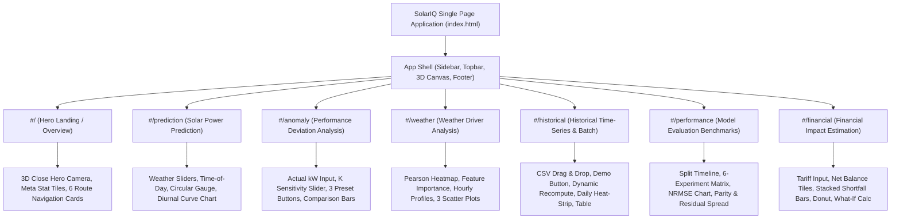

# SolarIQ UI Architecture & Navigation Map

This document outlines the client-side view hierarchy, navigation routing, and component layouts for the SolarIQ application.

---

## Page-by-Page View Structure

### 1. Persistent Application Shell
- **Three.js Canvas Background (`#bg-canvas`):** Single full-screen WebGL context rendering ground grid, instanced solar panel arrays with procedural cell textures, glowing sun with celestial arc positioning, and upward-drifting light particles.
- **Fixed Sidebar Navigation:**
  - Branding Logo (`⚡ SolarIQ`)
  - Route Links: Overview (`#/`), Prediction (`#/prediction`), Anomaly Detection (`#/anomaly`), Weather Analysis (`#/weather`), Historical Analysis (`#/historical`), Model Performance (`#/performance`), Financial Impact (`#/financial`).
  - Mobile behavior: Collapses to icon-only at $\le 900\text{px}$; converts to bottom navigation bar at $\le 600\text{px}$.
- **Sticky Top Bar:**
  - Facility Selector dropdown (`Plant 1`, `Plant 2`).
  - Default PPA Tariff input (₹/kWh).
  - API Health Status indicator dot (`/api/health`).
  - Theme Toggle button (`☀️`/`🌙`) with persistence in `localStorage`.
- **Global Footer:**
  - Persistent scientific operational notice regarding data seasonality limits.

---

### 2. Overview (`pages/home.js`)
- Hero section with gradient typography.
- Primary Call to Actions: *"Try a Prediction"* and *"Run Demo Analysis"*.
- 3 Live Telemetry Stat Tiles: Facilities tracked (2), Data observation span, Top-tier model accuracy ($R^2 = 0.995$).
- 6 Interactive Feature Cards with hover-lift motion and direct hash navigation.

---

### 3. Solar Power Prediction (`pages/prediction.js`)
- Left Column: Form Card
  - Plant ID selector (`4135001`, `4136001`).
  - Solar Irradiation slider & number input ($0.0\text{ to }1.2\text{ kW/m}^2$).
  - Ambient Temperature slider & number input ($15\text{ to }45\text{ °C}$).
  - Module Surface Temperature slider & number input ($15\text{ to }75\text{ °C}$).
  - Time-of-day Hour & 15-minute slot selector.
  - *"Typical conditions for this time"* button.
  - Debounced auto-prediction (300ms) and manual *"Predict"* button.
- Right Column: Result Cards
  - Animated headline expected power display (kW).
  - SVG circular gauge showing output as a percentage of plant daily peak.
  - 96-point typical day diurnal generation curve chart (`Chart.js`).
  - 3D reactivity: moves sun position via `setSunHour(hour)` and modulates panel glow via `setPower(ratio)`.

---

### 4. Anomaly Detection (`pages/anomaly.js`)
- Test Scenario Quick Presets:
  - Scenario 1: Normal Generation (Plant 1, Midday)
  - Scenario 2: Underperforming Output (Plant 2 Contract Benchmark)
  - Scenario 3: Zero Reading / Data Gap (Midday high irradiation with zero output)
- Input Controls: Weather parameters, Actual AC Power (kW), Sensitivity Multiplier ($K = 1.0\text{ to }6.0$).
- Output Metrics:
  - Dual comparison progress tracks (Expected vs Actual).
  - Residual kW ($+$ green, $-$ red/amber).
  - Percentage Deviation ($\ge 500\text{ kW}$ gate).
  - Classification chip (*"Within normal range"* vs *"Flagged for review"*).
  - Contextual diagnostic card (*"Possible things to check"*).
  - Investigation disclaimer callout.
  - Expandable *"How it is decided"* details block.

---

### 5. Weather Driver Analysis (`pages/weather.js`)
- Plant Scope filter (`All`, `Plant 1`, `Plant 2`).
- Visible association disclaimer banner.
- Pairwise Pearson Correlation Heatmap (CSS grid with color-coded correlation cells).
- Feature Importance horizontal bar chart ($>96\%$ irradiation dominance).
- Diurnal Hourly Generation Profiles for both plants.
- 3 Dedicated Scatter Sample plots:
  - Irradiation vs. AC Power
  - Module Temperature vs. AC Power
  - Ambient Temperature vs. AC Power
- Dynamic plain-English takeaways calculated directly from backend metrics.

---

### 6. Historical Analysis (`pages/historical.js`)
- Drag-and-drop CSV upload dropzone ($\le 5\text{ MB}$).
- *"Run with Demo Dataset"* button and *"Download Sample CSV Template"* anchor.
- Summary tiles: Rows used, dropped weather rows, flagged count & percentage, date range, net kWh balance.
- Control Toolbar: Local Plant Scope, Sensitivity ($K$), PPA Tariff, and *"Download Results CSV"*.
- Daily Heat-Strip showing frequency of flagged investigation candidates.
- Interactive Time-Series chart (Actual vs Expected vs Flagged Candidates) with range zoom buttons (`All`, `Last 24h`, `Last 7d`).
- Paginated and searchable flagged rows data table.

---

### 7. Model Performance (`pages/performance.js`)
- Seasonality limits warning banner.
- Visual Chronological Split Timeline (Train: 15 May – 06 Jun, Val: 07 – 11 Jun, Test: 12 – 17 Jun).
- Out-of-sample Random Forest benchmark score cards (Plant 1 $R^2 = 0.995$, Plant 2 $R^2 = 0.882$).
- 6-Experiment cross-validation matrix (Linear Regression, SVR, Random Forest) with best values highlighted in green.
- Grouped NRMSE % comparative bar chart.
- Code-styled tuned hyperparameter block.
- Actual vs Expected Parity scatter plot and 12-bin residual error distribution histogram.

---

### 8. Financial Impact (`pages/financial.js`)
- Empty state with quick demo launcher if no batch evaluation is active.
- Revenue balance stat tiles: Total Actual Generation, Flagged Anomalous Shortfall (₹), Total Shortfall (₹), and Generation Surplus (₹).
- Daily Stacked Shortfall bar chart (monetary impact per day across Plant 1 and Plant 2).
- Donut chart depicting Flagged Shortfall vs Baseline expected variance.
- *"What-If"* single 15-minute point valuation calculator (`POST /api/financial/convert`).
- *"Copy Executive Summary"* button for instant clipboard export.
- Financial disclaimer callout.
